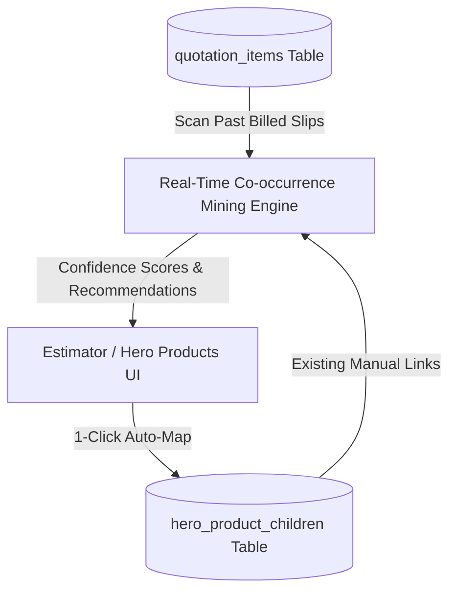

# Real-Time Analytics & Bundle Optimization Plan

**Project:** Sri Venkateshwara Trading & Co (QuoteFlow POS)  
**Document:** `Plan.md`  
**Purpose:** Architecture roadmap for automated real-time analytics and data-driven child product recommendations to augment the seller's manual Hero Product mappings.

---

## 1. Executive Vision

While the seller currently maps child products manually based on practical trade experience, the QuoteFlow database accumulates real counter quotation records over time. This plan outlines an automated intelligence layer that analyzes actual billing history to:
1. **Uncover Hidden Co-occurrences:** Automatically calculate which hardware items, clamps, and fittings are most frequently bought alongside any primary Hero Product.
2. **Recommend Child Add-ons:** Intelligently suggest unmapped accessories to the shopkeeper with measured confidence scores (e.g., *"PVC Pipe 4'' is billed with 4'' Solvent Cement in 82% of sales"*).
3. **Track Attachment & Retention Velocity:** Measure how often customers keep vs. remove suggested child products during POS negotiations.

---

## 2. Real-Time Data Pipeline Architecture



---

## 3. Core Analytics Metrics & Formulas

### 3.1. Item Co-occurrence Support & Confidence
For any Hero Product $H$ and candidate accessory $C$:

$$\text{Support}(H \cup C) = \frac{\text{Quotations containing both } H \text{ and } C}{\text{Total Quotations}}$$

$$\text{Confidence}(C \mid H) = \frac{\text{Quotations containing both } H \text{ and } C}{\text{Quotations containing } H} \times 100\%$$

* **Threshold:** If $\text{Confidence}(C \mid H) \ge 40\%$, the system flags item $C$ as a recommended child component.

### 3.2. Bundle Attachment Rate
Measures customer acceptance of bundled child items:

$$\text{Attachment Rate} = \frac{\text{Finalized Estimates where Child remained}}{\text{Estimates where Hero was added}} \times 100\%$$

* Items with $< 15\%$ retention can be flagged to the seller for review or bundle adjustment.

---

## 4. Planned Implementation Phases

### Phase 1: Co-occurrence Analytics API (`/api/analytics/recommendations`)
* **Endpoint:** `GET /api/analytics/hero-suggestions?heroId=:id`
* **Query:**
  ```sql
  SELECT 
    qi2.product_id,
    p.product_name,
    p.unit,
    COUNT(DISTINCT qi2.quotation_id) as joint_order_count,
    ROUND((COUNT(DISTINCT qi2.quotation_id) * 100.0 / total_hero.cnt), 1) as confidence_percentage,
    ROUND(AVG(qi2.quantity), 2) as suggested_default_qty
  FROM quotation_items qi1
  JOIN (
    SELECT COUNT(DISTINCT quotation_id) as cnt 
    FROM quotation_items 
    WHERE product_id = ?
  ) total_hero
  JOIN quotation_items qi2 ON qi1.quotation_id = qi2.quotation_id AND qi2.product_id != qi1.product_id
  JOIN products p ON qi2.product_id = p.id
  WHERE qi1.product_id = ?
    AND qi2.product_id NOT IN (SELECT child_product_id FROM hero_product_children WHERE hero_product_id = ?)
  GROUP BY qi2.product_id
  HAVING confidence_percentage >= 25.0
  ORDER BY confidence_percentage DESC
  LIMIT 5;
  ```

### Phase 2: UI Integration (Smart Suggestions Drawer)
* In `HeroProductsView.tsx`:
  - A **"Smart Recommendations"** badge next to each Hero Product showing suggestions derived from real sales data.
  - A 1-click **"Accept Suggestion"** button that copies the child product and suggested quantity directly into `hero_product_children`.
* In `EstimatorView.tsx`:
  - Display co-occurrence percentage tags (e.g., *"Billed together in 78% of past estimates"*).

### Phase 3: Revenue & Margin Optimization
* Compute total gross margin generated per bundle versus single-item sales.
* Suggest optimal bundle pricing to maximize counter turnover without sacrificing markup.
